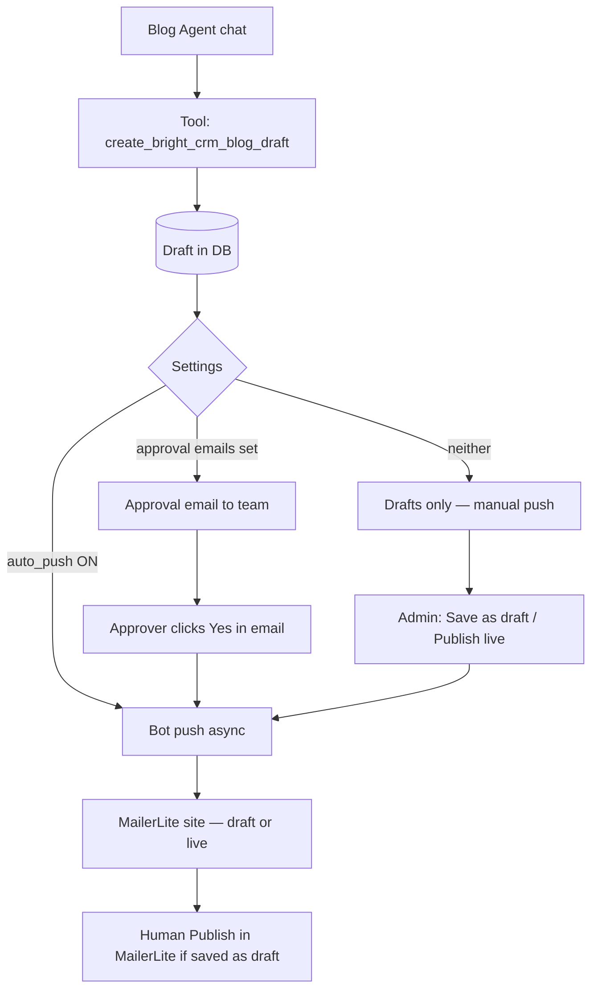

# Blog-2.0 — Standard Operating Procedure (SOP)

**Project:** Bright CRM (client site on MailerLite)  
**Admin:** `https://manageadmin.tech2globe.tech` → **Blog-2.0**  
**Scope:** AI Blog Agent, Drafts, MailerLite browser bot, approval emails.  
**Not in scope:** Main Tech2Globe Blog module (`/admin/blog`).

---

## 1. What each piece does

| Component | What it is | What it does *not* do |
|-----------|------------|------------------------|
| **Blog Agent** | Chat AI in Admin → Blog-2.0 → **Blog Agent** | Does not publish to MailerLite by itself unless auto-push is enabled |
| **Drafts** | Database rows of posts the agent (or tests) saved | Deleting a draft does **not** remove a post already on MailerLite |
| **MailerLite browser bot** | Playwright on the **server** (headless Linux) | Does not use MailerLite API for **website blog posts** (no blog API) |
| **MailerLite API token** | Settings → API fields | Used for **newsletter/subscribers** (Phase 2), not for site blog editor |
| **Approval emails** | HTML email with Preview / Yes / No links | Links hit the **public API** (`BACKEND_PUBLIC_URL`); approver does not need admin login |
| **Automations page** | Admin → **Automations** | **Scheduler not live yet** — placeholder for weekly Monday 12:00 IST runs |

---

## 2. End-to-end picture



---

## 3. Prerequisites (one-time)

Complete **Blog-2.0 → Setup checklist** and **MailerLite** settings.

| Item | Where | Why |
|------|--------|-----|
| Bot login email + password | MailerLite settings | Bot logs into MailerLite on the server |
| **Enable browser bot** | MailerLite settings | Required for any push |
| Approval emails (comma-separated) | MailerLite settings | Who receives review emails |
| MailerLite site ID | MailerLite settings | Which client site/blog to open |
| `BACKEND_PUBLIC_URL` | Server `.env` | Approval email links (Preview / Approve / Reject) |
| OpenAI / agent keys | Connect → AI | Blog Agent |
| **`mailerlite-session.json` on Linux server** | `storage/blog-2.0/` on VPS | Session cookies; **Windows `browser-profile` does not work on Linux** |

### Refresh MailerLite session (when OTP every time or “session expired”)

**On Windows PC (recommended):**

```bat
cd tech2globe-backend
npm run blog20:save-session
```

Log in in the browser → wait until **Step 7/7 Session saved**.

**Upload to production server:**

```bat
scp -i "%USERPROFILE%\.ssh\listing_auditor_ed25519" ^
  "D:\important files\Tech2globe\tech2globe-backend\storage\blog-2.0\mailerlite-session.json" ^
  root@129.121.135.248:/root/t2g_backend/storage/blog-2.0/
```

**On server:** `pm2 restart t2g-backend`

---

## 4. Workflow A — Write with Blog Agent (typical)

**Who:** Content / Sahil / admin with Blog-2.0 edit access  

1. Open **Blog-2.0 → Blog Agent**.  
2. Start a thread; ask for a post (topic, tone, keywords).  
3. Agent calls **`create_bright_crm_blog_draft`** → new row in **Drafts**.  
4. Open **Drafts** — verify title, status **Blog-2.0 only** (until pushed).  

**After save, the system automatically:**

- If **MailerLite bot enabled + auto-push ON** → starts bot push in background.  
- Else if **approval emails** configured → sends **approval request email** (no auto-push).  
- Else → draft stays internal until someone pushes manually.  

5. Duplicate titles are normal (each save = new row). **Delete** extras in Drafts.  

---

## 5. Workflow B — Approval email (team review)

**Who:** Approvers (emails in settings); ops monitors Drafts/bot  

1. Trigger email either:  
   - Agent save (when auto-push is **off** but approval emails exist), or  
   - **Drafts → Send approval email** on a specific draft.  
2. Approvers receive email with:  
   - **Preview** — read post in browser  
   - **Yes — save as draft on website** (or **Publish live** if enabled)  
   - **Revise / No** — per link design  
3. When approver clicks **Yes**:  
   - Decision recorded; bot push runs **in background** (same as manual push).  
   - Approver sees a thank-you page; **confirmation email** when push finishes or fails.  
4. If bot is **disabled**, approval still records but push must be done manually from Drafts.  

**Requirements:** `BACKEND_PUBLIC_URL` must be the public API base (e.g. `https://api…`) so links work from Gmail/Outlook.

**Test:** MailerLite settings → **Test approval email**.

---

## 6. Workflow C — Manual push from Drafts

**Who:** Admin with Blog-2.0 edit  

1. **Drafts** → choose draft → **Save as draft** (MailerLite draft) or **Publish live** (if allowed).  
2. API returns **202 Push started** immediately (bot runs on server; do not wait for page to load).  
3. Watch **MailerLite bot** panel: steps 1–7, progress bar.  
4. **OTP (email verification):**  
   - MailerLite emails code to **bot login inbox** (not your personal MailerLite tab).  
   - While bot shows **running** / Step 2, enter code in **yellow banner → Submit OTP**.  
   - Use **Stop bot** only if stuck; then **Retry push**.  
5. Success: draft status **On MailerLite** or push complete message.  
6. **Human:** open MailerLite dashboard → review → **Publish** if saved as draft only.  

---

## 7. MailerLite bot — technical steps (each push)

| Step | Bot action |
|------|------------|
| 1 | Start job, lock (one push at a time) |
| 2 | Load session JSON (Linux) / profile (Windows dev) |
| 3 | Open client blog on MailerLite |
| 4 | Create post / open editor |
| 5 | Fill title, body, image if any |
| 6 | Save (draft or publish per button) |
| 7 | Persist session JSON again (reduces future OTP) |

**OTP wait:** up to ~15 minutes (`BLOG_20_BOT_OTP_WAIT_MS`). Bot may click **Send email code** again every 3 minutes while waiting.

**Debug screenshots (server):** `uploads/blog20-bot-debug/`  
**Logs:** `pm2 logs t2g-backend` → filter `[blog-2.0-bot]`

---

## 8. Email catalog

| Email | When sent | Recipient |
|-------|-----------|-----------|
| **Approval request** | Agent save (approval mode) or **Send approval email** | `approval_emails` in settings |
| **Approval test** | **Test approval email** button | Same list |
| **Decision confirmation** | After approver Yes/No and after bot push completes/fails | Approver + configured flow |
| **MailerLite OTP** | MailerLite security (not sent by our app) | **Bot login mailbox** only |

Newsletter blast emails (Monday 12:00 IST campaign) are **Phase 2** — API token + scheduler; not the same as website blog push.

---

## 9. Settings that change behavior

| Setting | Effect |
|---------|--------|
| **MailerLite bot enabled** | Master switch for Playwright push |
| **Auto-push after agent save** | Agent → immediate bot (skips approval email on save) |
| **Approval emails** | Agent save → email team instead of auto-push (when auto-push off) |
| **Publish live in approval emails** | Shows live-publish option to approvers |
| **Newsletter send timing** | On approve vs scheduled (campaign Phase 2) |

**Do not enable auto-push and expect approval on the same save** — auto-push takes precedence in agent tool logic.

---

## 10. Roles & responsibilities

| Role | Tasks |
|------|--------|
| **Super admin** | Users, module access, AI keys, `BACKEND_PUBLIC_URL`, deploy |
| **Blog-2.0 editor** | Agent, Drafts, push, OTP entry, MailerLite settings |
| **Approver** | Email links only; no admin login required |
| **Client / MailerLite owner** | Final **Publish** on MailerLite, API token, sender verification |
| **DevOps** | Session file on VPS, nginx timeouts, `pm2`, disk for debug screenshots |

---

## 11. Production deploy (reference)

**Server:** `129.121.135.248` — backend `/root/t2g_backend`, admin `/root/t2g_admin`

```bash
# Backend (branch authFix)
cd /root/t2g_backend && git pull origin authFix && pm2 restart t2g-backend

# Admin (branch main)
cd /root/t2g_admin && git pull origin main && npm run build && pm2 restart t2g-admin
```

---

## 12. Troubleshooting

| Symptom | Likely cause | Action |
|---------|--------------|--------|
| **504** on push | Old proxy waited for whole bot run | Deploy backend **202 async** + admin latest; ignore 504 if bot still running |
| **OTP every push** | Missing/expired `mailerlite-session.json` on VPS | Re-run save-session on PC → scp JSON → restart backend |
| **OTP submitted, nothing happens** | Bot not running or wrong code | Push again; submit while progress bar active; check bot inbox |
| **Draft stuck “Pushing…”** | Bot killed / DB out of sync | **Stop bot** → Retry; or deploy reconcile (`getMailerLiteBot/status`) |
| **Approval links broken** | `BACKEND_PUBLIC_URL` wrong | Fix `.env`, restart backend |
| **Blank agent** | AI keys missing | Connect → AI Integrations |
| **Duplicate drafts** | Agent saved multiple times | Delete extras in Drafts |

---

## 13. Roadmap (not operational yet)

- **Automations:** scheduled topic → write → draft → newsletter (Admin → Automations).  
- **Newsletter API:** create/send campaigns on approve or Monday schedule.  
- **Optional:** auto-read OTP from bot mailbox (IMAP / Microsoft Graph).  

For setup details see **`docs/BLOG-2.0-SETUP.md`**.  
For future features see **`docs/BLOG-2.0-FUTURE.md`**.

---

*Document version: Oct 2026 — matches Blog-2.0 module in `t2g_backend` (authFix) + `t2g_admin` (main).*
